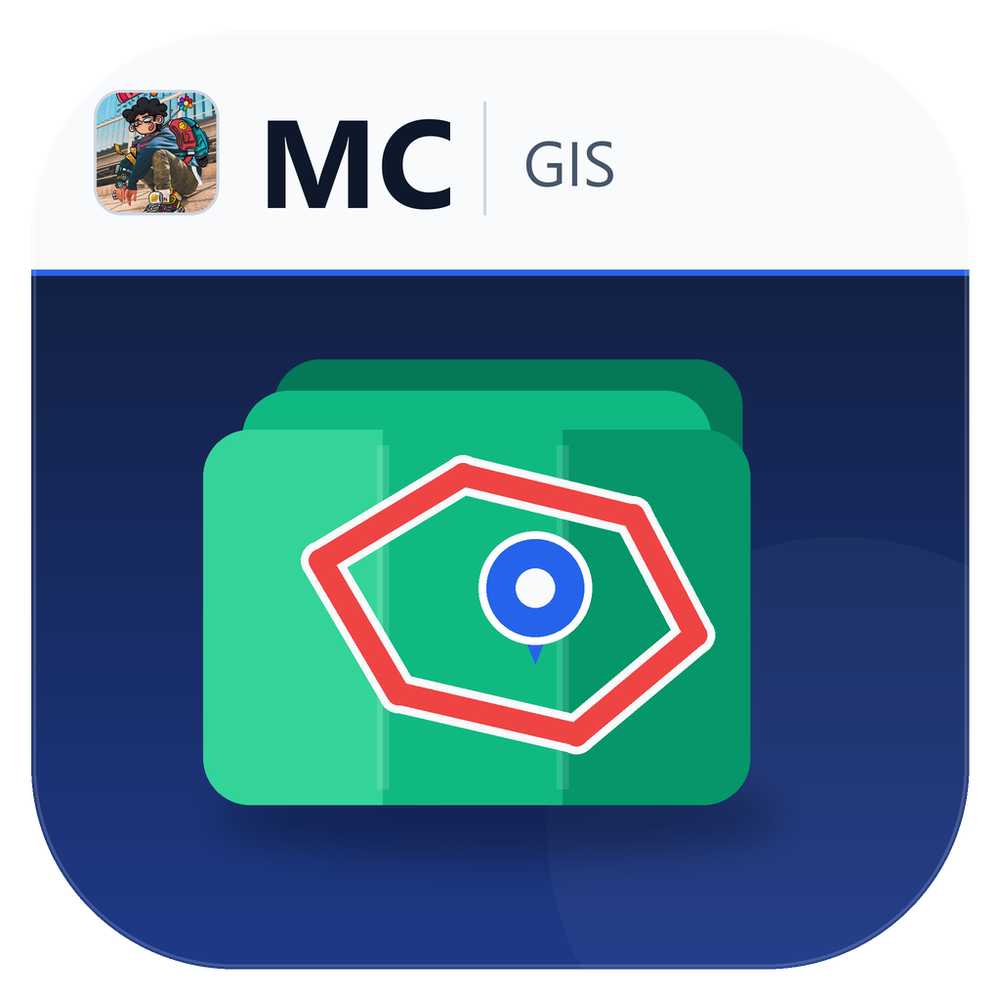
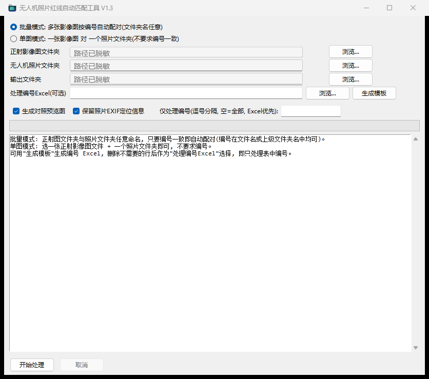
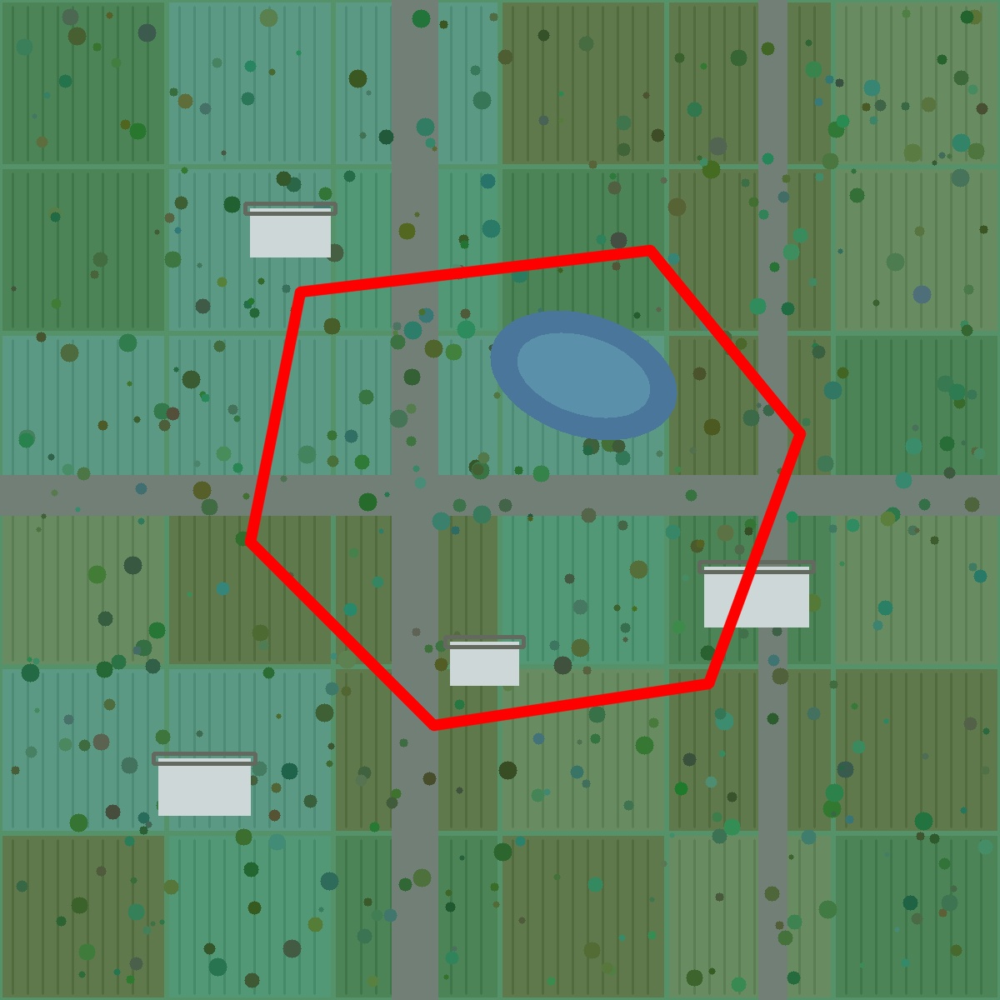
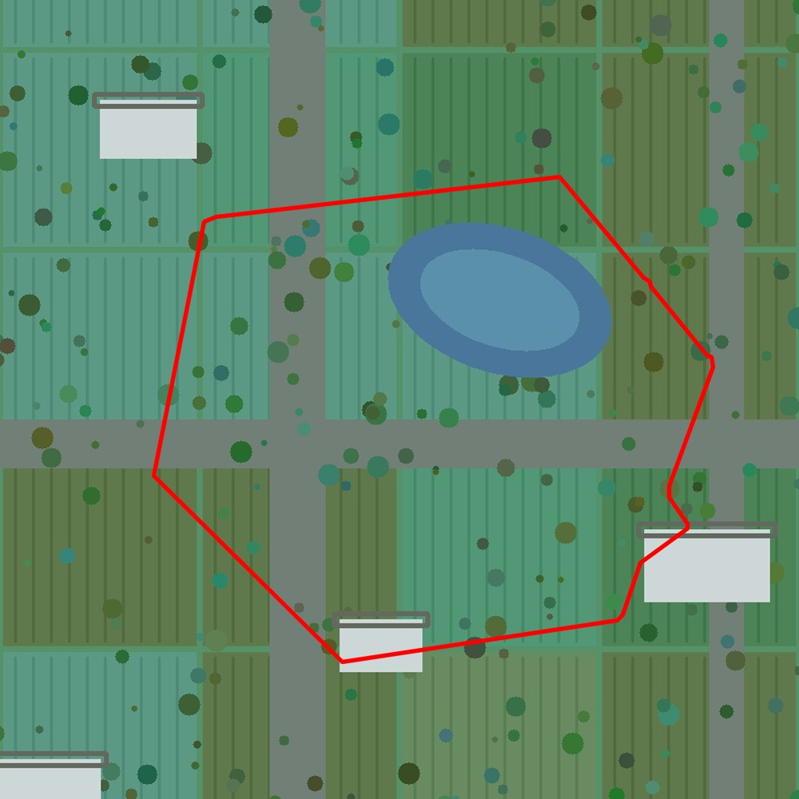
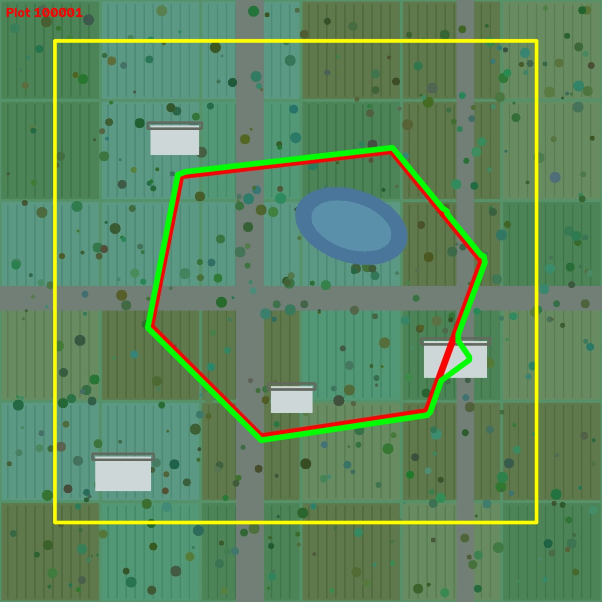

<div align="center">
  
  <h1>无人机照片红线自动匹配工具</h1>
  <p><strong>Redline Matcher</strong></p>
  <p>从正射影像提取红线，结合图像特征、无人机 RTK/云台信息和局部精化，将红线辅助转绘到同编号无人机照片上。</p>
  <p>Extract red boundaries from orthophotos and transfer them to matching drone photos with image features, camera metadata, and local refinement.</p>
  <p>
    <a href="#简体中文">简体中文</a> ·
    <a href="#english">English</a> ·
    <a href="https://github.com/SoulRui/redline-matcher/releases/latest"><strong>下载 Windows 版 / Download</strong></a>
  </p>
  <p>
    
    
    
  </p>
</div>

> **隐私 / Privacy：** 本仓库不包含原始无人机照片、正射影像、真实编号表、真实乡镇村名或真实坐标。主页示例均由程序生成，界面截图中的本地路径已遮盖。处理真实照片时，默认会保留 EXIF；公开分享输出前请检查定位信息，必要时使用 `--no-exif`。

> **用途 / Accuracy：** 自动匹配结果用于辅助绘图，不保证在所有地形、纹理和拍摄条件下都正确。请结合对照预览和处理报告进行人工复核。

---

## 简体中文

### 版本说明

本仓库仅发布当前最新的 **V1.3（Release 标签 `v1.3.0`）**。V1.0–V1.2 的旧程序、历史测试数据及原始工作文件不包含在仓库中。

### 主要功能

- **红线提取**：红色阈值分割、角落图例剔除、暗红干扰过滤、碎片归组、断口封闭与多边形简化。
- **图像配准**：RootSIFT 特征匹配、云台航向预旋转、相似变换/单应估计和几何门控。
- **相机模型**：读取 DJI XMP 的 RTK 位置、云台姿态、焦距及数码变焦，辅助地面投影。
- **局部精化**：沿红线进行 NCC 模板匹配，支持整体平移、相似修正及局部贴合。
- **批量与单图模式**：按编号自动配对，或让一张正射图对应整个照片文件夹。
- **结果分类**：输出带红线照片、红线内部边框标注、未覆盖红线照片存档及对照图。
- **处理报告**：生成 CSV，记录状态、匹配方式、内点、精化信息和输出路径。
- **编号筛选**：可按逗号分隔编号或 Excel 编号表处理部分地块。

### 界面与脱敏示例

<p align="center">
  
</p>

下面图片全部由程序生成，不对应任何真实地点：

| 正射影像中的红线 | 转绘到照片后的结果 |
| --- | --- |
|  |  |

<p align="center">
  
  <br>
  <sub>对照预览中的绿线表示提取红线，黄框表示照片覆盖范围，编号 100001 为虚构演示编号。</sub>
</p>

### 下载与运行

1. 打开 **[Releases 页面](https://github.com/SoulRui/redline-matcher/releases/latest)**。
2. 下载 **`redline-matcher-v1.3.0-windows-x64.exe`**。
3. 双击运行，无需安装 Python、OpenCV 或 Microsoft Excel。
4. 发布文件为 **Windows 64 位免安装程序**。程序未购买代码签名证书，Windows SmartScreen 可能提示；请只从本仓库 Releases 下载，并核对发布页的 SHA-256。

```powershell
certutil -hashfile "redline-matcher-v1.3.0-windows-x64.exe" SHA256
```

### 批量模式

1. 将带红线的正射影像放在同一个文件夹中。
2. 将无人机特写照片放在另一个文件夹中，支持嵌套子文件夹。
3. 确保正射图与照片使用相同的数字编号：编号可位于文件名或上级文件夹名中，也支持 `12345号图斑` 形式。
4. 可选：在“处理编号Excel”中选择编号表，或在“仅处理编号”中输入逗号分隔的编号。
5. 选择输出文件夹，勾选是否生成对照预览和保留 EXIF，然后开始处理。

编号规则：

- 数字位数不限，优先识别 `数字 + 号`。
- 年份形式（如 `2025年`、`2026 年`）不会作为地块编号。
- 只有正射图没有照片、或只有照片没有正射图的编号会跳过并记录提示。
- 支持 `.jpg`、`.jpeg`、`.tif`、`.tiff`、`.png`、`.bmp`。
- Excel 使用 `.xlsx` 或 `.xlsm`；旧版 `.xls` 请先另存为 `.xlsx`。示例 [processing-ids-example.xlsx](examples/processing-ids-example.xlsx) 只含虚构编号。

### 单图模式

在界面中选择“单图模式”，选择一张正射影像文件和一个照片文件夹即可，不要求编号一致。程序会递归收集该文件夹内的照片并进行匹配。

### 处理流程

1. 从正射图提取一条或多条红线多边形。
2. 按云台角度预旋转照片，使用 RootSIFT 和几何门控寻找可信配准。
3. 特征配准不足时，尝试 NCC 引导配准；强特征匹配的无定位照片也可直接转绘。
4. 使用相机模型或匹配链将红线投影到每张照片。
5. 沿红线进行局部模板匹配精化，并判断红线是否穿过画面、是否覆盖整幅画面。
6. 保存结果、对照预览和 CSV 报告。

平地模型、纹理变化、植被遮挡、重复纹理、红屋顶干扰及云台/RTK 误差都可能影响结果。默认相机参数针对 DJI M3E 广角相机优化，其他相机或复杂地形尤其需要人工复核。

### 输出结构

```text
输出文件夹/
├── 100001/
│   └── 100001_closeup_红线.jpg
├── 红线不在画面/
│   ├── 100001/
│   └── 对比图/
├── 对照预览/
│   └── 100001_对照图.jpg
└── 处理报告.csv
```

原始正射图和照片不会被修改。输出目录建议与输入目录分开。

### 隐私与公开发布检查

- 本仓库中的截图、示例图和编号表均为虚构或脱敏内容。
- 真实无人机照片可能包含 GPS、RTK、设备信息和拍摄时间。程序默认在 JPEG 输出中保留 EXIF。
- 如需公开分享输出，请先检查元数据；使用 `--no-exif` 可不保留输出 EXIF。
- 原始输入文件、历史版本 EXE、真实编号模板和测试输出均通过 `.gitignore` 排除。

### MC 统一图标模板

本项目遵循《MC Software Visual Identity System V1.0》：

- `assets/creator-avatar.png`：作者 GitHub 头像。
- `assets/icon.svg`：1024 × 1024 可编辑模板，保留 `mc-brand-header`，替换 `app-artwork` 可扩展其他应用。
- `assets/icon.png`：1024 × 1024 PNG。
- `assets/icon.ico`：16、24、32、48、64、128、256 像素，小尺寸已锐化。

顶部固定为“作者头像 + MC 大写品牌 + 应用短名称”。本项目使用 **MC GIS**、绿色地图、红色边界及定位标记，与其他 MC 应用保持统一家族视觉。

### 从源码运行

要求：Windows、Python 3.10 或更高版本，以及 Python 自带的 tkinter。

```powershell
py -m venv .venv
.\.venv\Scripts\Activate.ps1
python -m pip install -r requirements.txt
python redline_matcher.py
```

依赖包括 OpenCV、NumPy、Pillow、openpyxl 和 piexif。

### 自行打包 EXE

```powershell
python -m pip install -r requirements.txt PyInstaller
pyinstaller --clean redline_matcher.spec
```

输出位于 `dist/无人机照片红线自动匹配工具V1.3.exe`，打包配置已包含 MC 窗口与 EXE 图标。

### 命令行用法

以下使用 Release 附件文件名；自行打包时请替换为实际 EXE 路径。

```powershell
# 批量模式，并关闭输出 EXIF 保留
.\redline-matcher-v1.3.0-windows-x64.exe --cli --ref "D:\Demo\Orthomosaics" --photo "D:\Demo\Photos" --out "D:\Demo\Output" --no-exif

# 单图模式
.\redline-matcher-v1.3.0-windows-x64.exe --cli --single --ref "D:\Demo\100001.jpg" --photo "D:\Demo\Photos" --out "D:\Demo\Output"

# 只处理两个编号，不生成对照预览
.\redline-matcher-v1.3.0-windows-x64.exe --cli --ref "D:\Demo\Orthomosaics" --photo "D:\Demo\Photos" --out "D:\Demo\Output" --ids "100001,100002" --no-preview

# 使用 Excel 编号表
.\redline-matcher-v1.3.0-windows-x64.exe --cli --ref "D:\Demo\Orthomosaics" --photo "D:\Demo\Photos" --out "D:\Demo\Output" --ids-file "D:\Demo\ids.xlsx"
```

窗口版 EXE 的终端日志可能不可见；需要完整控制台输出时，可运行 `python redline_matcher.py` 加相同参数。

### 项目结构

```text
redline-matcher/
├── assets/                       # MC 图标、SVG 模板与作者头像
├── docs/images/                  # 脱敏界面截图和程序生成的示例图
├── examples/                     # 虚构编号 Excel 示例
├── redline_matcher.py            # 最新 V1.3 源码
├── redline_matcher.spec          # PyInstaller 配置
├── requirements.txt
└── README.md
```

### 许可

目前尚未单独指定开源许可证。公开源代码不等同于授予复制、修改或再分发的开源授权。

---

## English

### Overview

Redline Matcher extracts red parcel boundaries from orthophotos and transfers them to corresponding drone close-up photos. It combines red-color segmentation, RootSIFT registration, DJI RTK/gimbal metadata, camera projection, and NCC-based local refinement.

**Only the latest V1.3 source and executable are published here, under tag `v1.3.0`. Older executables and working datasets are excluded.**

### Privacy and accuracy

- No original drone photos, orthophotos, real plot lists, real town/village names, or real coordinates are included.
- All documentation images are generated from synthetic parcels. Local paths in the application screenshot are redacted.
- JPEG output preserves EXIF by default. Review location metadata before sharing, and use `--no-exif` when appropriate.
- Automatic transfer is an assistance tool, not an accuracy guarantee. Always review the comparison previews and CSV report.

### Features

- Red-boundary extraction with legend removal, dark-red filtering, fragment grouping, gap closing, and polygon simplification.
- RootSIFT registration, gimbal-yaw pre-rotation, similarity/homography estimation, and geometric gates.
- DJI XMP metadata for RTK position, gimbal attitude, focal length, and digital zoom.
- NCC-based translation, similarity refinement, and optional local fitting along the boundary.
- Batch pairing by numeric IDs or single-orthophoto mode.
- Output photos, inside-boundary frames, out-of-frame archiving, comparison images, and a CSV report.
- Optional filtering by comma-separated IDs or an Excel workbook.

### Screenshots and synthetic example

<p align="center">
  
</p>

| Red lines in the synthetic orthophoto | Transferred result on the synthetic close-up |
| --- | --- |
|  |  |

<p align="center">
  
</p>

These images do not represent a real location. ID `100001` is fictional.

### Download and run

1. Open **[Releases](https://github.com/SoulRui/redline-matcher/releases/latest)**.
2. Download **`redline-matcher-v1.3.0-windows-x64.exe`**.
3. Double-click it; Python, OpenCV, and Microsoft Excel are not required.
4. The portable 64-bit Windows executable is not digitally signed with a purchased code-signing certificate. Download only from this repository and compare the SHA-256 in the release notes.

```powershell
certutil -hashfile "redline-matcher-v1.3.0-windows-x64.exe" SHA256
```

### Batch and single-image modes

For batch mode, place red-lined orthophotos in one folder and close-up drone photos in another. Matching numeric IDs can appear in filenames or parent folder names. `12345号图斑`-style names are supported, digits have no fixed length, and year forms such as `2025年` are excluded. Items with only an orthophoto or only photos are skipped with a log message.

Supported images: `.jpg`, `.jpeg`, `.tif`, `.tiff`, `.png`, and `.bmp`. Excel workbooks use `.xlsx` or `.xlsm`; save legacy `.xls` files as `.xlsx` first. A fictional [ID workbook](examples/processing-ids-example.xlsx) is included.

For single-image mode, select one orthophoto and a photo directory. IDs do not need to match, and photos are collected recursively.

### Processing and output

The app extracts boundary polygons, searches for trustworthy feature registration, falls back to NCC-guided registration when needed, projects boundaries with match chains or the camera model, refines them locally, and writes results with comparison previews and a CSV report.

Flat-ground assumptions, changing vegetation, repeated textures, red-roof interference, occlusion, and RTK/gimbal errors can affect accuracy. Default camera constants target the DJI M3E wide camera; other cameras and complex terrain require additional review.

```text
Output/
├── 100001/
│   └── 100001_closeup_红线.jpg
├── 红线不在画面/
│   ├── 100001/
│   └── 对比图/
├── 对照预览/
│   └── 100001_对照图.jpg
└── 处理报告.csv
```

Inputs are not modified. Use a separate output directory and review all automated results.

### Reusable MC icon template

This project follows MC Software Visual Identity System V1.0. `assets/icon.svg` is the editable 1024 × 1024 source; keep `mc-brand-header` unchanged and replace `app-artwork` for other applications. `assets/icon.png` is the 1024 × 1024 PNG, and `assets/icon.ico` contains sharpened 16–256 px variants. `assets/creator-avatar.png` is the creator's GitHub avatar.

The fixed header contains the creator avatar, uppercase MC brand, and short application name. This project uses **MC GIS**, a green map, a red parcel boundary, and a location marker.

### Run from source

Requirements: Windows, Python 3.10 or later, and tkinter.

```powershell
py -m venv .venv
.\.venv\Scripts\Activate.ps1
python -m pip install -r requirements.txt
python redline_matcher.py
```

Dependencies: OpenCV, NumPy, Pillow, openpyxl, and piexif.

### Build the executable

```powershell
python -m pip install -r requirements.txt PyInstaller
pyinstaller --clean redline_matcher.spec
```

Output: `dist/无人机照片红线自动匹配工具V1.3.exe`. The spec includes the MC window and executable icons.

### Command line

```powershell
# Batch mode without preserving output EXIF
.\redline-matcher-v1.3.0-windows-x64.exe --cli --ref "D:\Demo\Orthomosaics" --photo "D:\Demo\Photos" --out "D:\Demo\Output" --no-exif

# Single orthophoto mode
.\redline-matcher-v1.3.0-windows-x64.exe --cli --single --ref "D:\Demo\100001.jpg" --photo "D:\Demo\Photos" --out "D:\Demo\Output"

# Filter IDs and skip previews
.\redline-matcher-v1.3.0-windows-x64.exe --cli --ref "D:\Demo\Orthomosaics" --photo "D:\Demo\Photos" --out "D:\Demo\Output" --ids "100001,100002" --no-preview

# Use an Excel ID list
.\redline-matcher-v1.3.0-windows-x64.exe --cli --ref "D:\Demo\Orthomosaics" --photo "D:\Demo\Photos" --out "D:\Demo\Output" --ids-file "D:\Demo\ids.xlsx"
```

Console output may not be visible in the windowed EXE. Use `python redline_matcher.py` with the same arguments for full terminal logs.

### Project layout

```text
redline-matcher/
├── assets/                       # MC icons, SVG template, and creator avatar
├── docs/images/                  # Redacted screenshot and synthetic examples
├── examples/                     # Fictional Excel ID list
├── redline_matcher.py            # Latest V1.3 source
├── redline_matcher.spec          # PyInstaller configuration
├── requirements.txt
└── README.md
```

### License

No separate open-source license has been specified yet. Making source public does not, by itself, grant open-source rights to copy, modify, or redistribute it.
